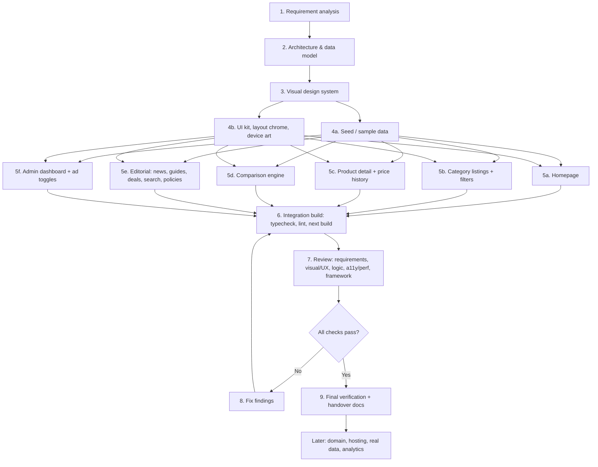

# Software Development Flow

This follows the "Complete website development pipeline" from the business plan (section 8), adapted to how it is actually executed here.

## Stages

| # | Stage | Output | Status |
|---|-------|--------|--------|
| 1 | Requirement analysis | `docs/REQUIREMENTS.md` | done |
| 2 | Architecture & data model | `src/lib/types.ts`, `src/lib/categories.ts`, `src/lib/data.ts`, `src/lib/store.ts` | done |
| 3 | Design system | `src/app/globals.css` tokens + glass utilities | done |
| 4a | Sample data | `data/*.json` (42 products, 14 articles, 8 guides) + `npm run validate:data` | done |
| 4b | UI kit & chrome | `src/components/ui`, `src/components/layout`, `src/components/device-art.tsx`, compare store/tray | done |
| 5a–f | Pages | home, catalog, product, compare, editorial (news, guides, deals, search, methodology, policies, contact), admin | done |
| 6 | Integration build | `tsc`, `npm run lint`, `npm run build` all clean | done |
| 7 | Review | browser run of all 81 routes + 8 interaction tests (`npm run screenshots`), visual review of desktop/mobile/dark screenshots, admin end-to-end save test | done |
| 8 | Fix loop | fixed: compare grid column widths, scroll-reveal visibility (reduced motion + no-JS), React-compiler lint errors, admin shell Suspense, dynamic routes failing to regenerate after admin edits | done |
| 9 | Final verification | final screenshots in `screenshots/final/`, handover README | done |

## Architecture at a glance

- **Framework:** Next.js 16 (App Router, React 19, TypeScript), Tailwind CSS v4, `motion` for animation, `recharts` for graphs, `lucide-react` icons.
- **Rendering:** Cache Components are on. Public data is read through `'use cache'` functions tagged `catalog` in `src/lib/data.ts`; product/category/article routes are prerendered with `generateStaticParams`. Admin saves write JSON and call `updateTag('catalog')` so pages refresh immediately.
- **Data:** JSON files in `data/` (products, news, guides, settings). No database needed yet — swap `src/lib/store.ts` for a real DB later without touching pages.
- **Client state:** the comparison selection (max 5, same category) lives in a small store persisted to `localStorage`. Wishlists and accounts are a later phase.
- **Admin:** `/admin`, protected by `ADMIN_PASSWORD` (see README) via `src/proxy.ts` + a signed cookie.
- **Images:** product visuals are generated SVG device renders (`DeviceArt`) so no copyrighted photos ship; real photos can be added per product later via `image` field.
